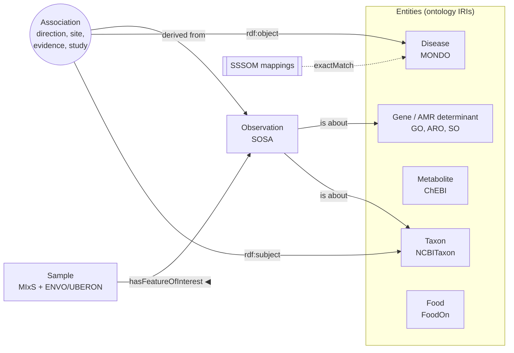

# MiCoKnowGraph

A collaborative, interoperable knowledge-graph (KG) blueprint for microbiome research. It is a personal draft prepared as a starting point for BioHackathon Europe 2026, Project 16 (ELIXIR Microbiome Community), partnered with Project 11 VERDANT. It is not the project's official repository.

## Where to start

| You are… | Read |
|---|---|
| New to the project | [Onboarding](onboarding.md): set up and run everything in 15 minutes |
| New to RDF, ontologies or SPARQL | [Knowledge-graph primer](kg-primer.md) |
| Adding classes, slots or data | [Modelling guide](modelling-guide.md) |
| A domain expert with questions the KG should answer | [Use cases](use-cases.md) |
| Working on mappings or VERDANT | [VERDANT integration](verdant-integration.md) |
| Wondering why something is modelled the way it is | The decision records (ADRs) |

## The design in one picture

- **Observations** are raw per-sample measurements.
- **Associations** are claims made from them (or taken from the literature) and carry their context and evidence.
- **Mappings** connect identifiers from different ontologies, so a DOID-coded record from one resource still answers a MONDO-coded question.
