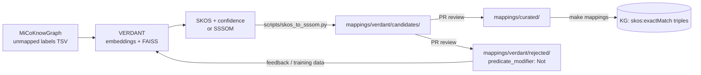

# VERDANT integration (Project 11)

[VERDANT](https://github.com/elixir-europe/biohackathon-projects-2026/blob/main/11.md) builds AI-generated SKOS mappings (exactMatch, closeMatch, relatedMatch) from vocabulary terms to ontologies and knowledge bases, with an expert pre-check loop and a federated SPARQL endpoint. It will enrich a subset of the ELIXIR Microbiome Community KG.

This page is a **draft exchange contract**, to be agreed with the VERDANT leads before the event.

## Data flow



## 1. MiCoKnowGraph → VERDANT

`build/verdant-input/unmapped-terms.tsv` (tab-separated):

| column | example |
|---|---|
| `term_id` | `micokg:term/habitat/sewage` |
| `label` | `sewage` |
| `context_slot` | `env_medium` |
| `source_kg` | `infores:gutmdisorder` |
| `suggested_target_ontology` | `ENVO` |

Sources:
- free-text habitat, sample-type, host and disease labels from the landscape KGs;
- labels found during real-data ingestion (Day 4).

## 2. VERDANT → MiCoKnowGraph

Preferred: **SSSOM TSV**. Also accepted: **Turtle** with plain SKOS triples, or reified `owl:Axiom` mappings with `sssom:confidence`. See `tests/fixtures/verdant-sample.ttl`.

```bash
python scripts/skos_to_sssom.py verdant-output.ttl \
  -o mappings/verdant/candidates/habitat.sssom.tsv \
  --mapping-set-id https://w3id.org/micokg/mappings/verdant/habitat \
  --tool-version 0.3.0
```

Every candidate row gets:
- `mapping_justification: semapv:SemanticSimilarityThresholdMatching`
- `mapping_tool: VERDANT`
- the tool version and a confidence score
- **no** `reviewer_id`

## 3. Review

Curators (Group C) review candidates in a pull request:

| Decision | Action |
|---|---|
| Accept | Move the row to `mappings/curated/<topic>.sssom.tsv`, add `reviewer_id` (ORCID), keep the original confidence |
| Accept with a different predicate | As accept, change `predicate_id` (e.g. exact → close), and explain in `comment` |
| Reject | Move the row to `mappings/verdant/rejected/`, set `predicate_modifier: Not`, and give the reason in `comment` |

Rejected rows are published so VERDANT can use them as negative training examples.

## 4. How mappings are used in the KG

- `make mappings` validates SSSOM files and writes plain `skos:exactMatch` / `closeMatch` triples. The CLI's own output is reified `owl:Axiom`s, which are hard to query.
- Queries expand identifiers with `?disease (skos:exactMatch|^skos:exactMatch)?/rdfs:subClassOf* ?queryDisease`. See `queries/uc3-host-microbiome-cancer/cq01-*.rq`.
- Only **curated** mappings are loaded into the KG used by tests. Candidates are not.

## Open points to agree with VERDANT

1. The identifier scheme for free-text labels, i.e. who mints `micokg:term/...` IDs.
2. Target ontologies and versions: ENVO, UBERON, NCBITaxon, MONDO, ChEBI, FoodOn?
3. Confidence calibration: is 0.8 comparable across target ontologies?
4. Endpoint URL, and whether MiCoKnowGraph example queries should be loaded there (SIB `sh:SPARQLExecutable` files from `make spex`).
5. Update cadence and versioning of mapping sets.
